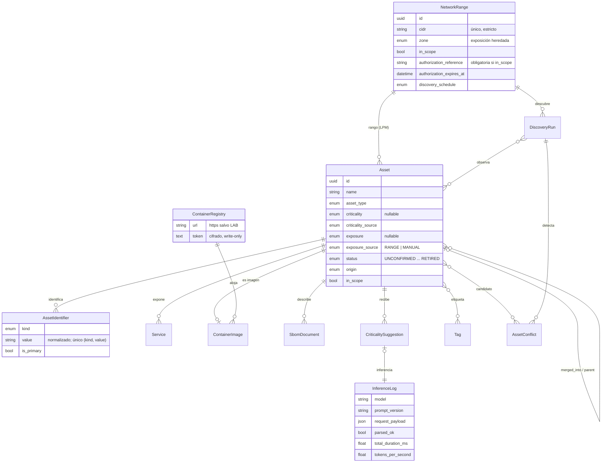
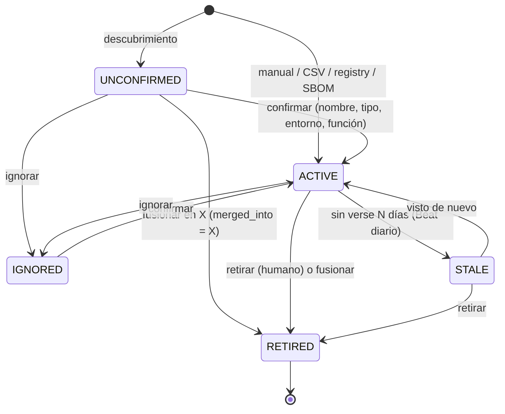

# Módulo 2 · Inventario de activos

Especificación final **tal como quedó implementada**. Las desviaciones respecto a la
especificación original están en la última sección y, con más detalle, en
[`02-assets-PROGRESS.md`](02-assets-PROGRESS.md).

## Rol del módulo

El inventario es el **hub** de Phylax: el módulo de vulnerabilidades obtiene de aquí sus
objetivos (`get_scan_targets()`) y el scoring obtiene el contexto de negocio
(`get_asset_context()`). Mantiene el registro canónico de activos, los enrola por cinco canales,
resuelve su identidad sin duplicarlos, captura su contexto, define el **alcance autorizado** y
gestiona la sugerencia de criticidad con un **LLM local** con humano en el ciclo.

**Sin agentes y sin credenciales de host.** La única credencial almacenada es un token de solo
lectura de registry, cifrado. El contrato de descubrimiento (`DiscoveredHost`) es agnóstico de
la fuente para que un agente futuro envíe el mismo DTO.

## Canales de enrolamiento

| Canal | Entrada | Estado inicial | Implementación |
|---|---|---|---|
| Alta manual | Formulario con identificadores en línea | `ACTIVE` | `services.create_asset` |
| Importación CSV | Dry-run → confirmar | `ACTIVE` | `csv_io.plan_import` / `execute_import` |
| Descubrimiento nmap | Barrido / escaneo de servicios de un rango autorizado | `UNCONFIRMED` | `discovery.services.execute_run` → `upsert_discovered_host` |
| Imagen de contenedor | Referencia (+ digest) y registry | `ACTIVE` | `registry_services.register_container_image` |
| SBOM | CycloneDX / SPDX JSON | `ACTIVE` (o asociado) | `sbom.inspect_sbom` / `attach_sbom` |

## Apps

```
apps/core/       TimeStampedModel, UUIDModel, EncryptedTextField (MultiFernet), rotate_field_encryption
apps/assets/     modelos, enums, normalización, services + contracts, CSV, SBOM, registries, UI
apps/discovery/  perfiles nmap, runner, parser defusedxml, DiscoveryRun, tareas Celery
apps/llm/        cliente Ollama, InferenceLog, prompts versionados, estado GPU/CPU
```

Interacción entre apps **solo** vía `assets/services.py` y `assets/contracts.py` (D6).

## Modelo de datos



`django-simple-history` registra `Asset`, `AssetIdentifier` y `NetworkRange`. `PendingUpload`
guarda cargas en dos pasos (CSV, SBOM) ligadas a su usuario y con caducidad de 1 h.

## Ciclo de vida



- Confirmar sin criticidad encola una sugerencia del LLM.
- `IGNORED`: el descubrimiento actualiza `last_seen` pero no lo devuelve a la cola ni a objetivos.
- `STALE` solo aplica a activos observados alguna vez (`last_seen` no nulo); `PHYLAX_ASSET_STALE_DAYS`.
- `RETIRED` nunca se borra físicamente. Fusionar mueve identificadores, servicios (conservando el
  `last_seen` más reciente), SBOM, sugerencias e hijos, y resuelve los conflictos asociados.

## Identidad

Precedencia `IMAGE_DIGEST > MAC > FQDN > IPV4/IPV6`. Si los identificadores observados apuntan a
activos distintos se registra un `AssetConflict` y **no se modifica ningún activo** (D4). La
normalización (`assets/normalization.py`) rechaza loopback/multicast/link-local (salvo LAB), MAC
nula/broadcast, FQDN fuera de RFC 1123, digests mal formados y URL que no sean http(s).

## Exposición y alcance

- **Exposición** determinista (D2): zona del rango por *longest-prefix match* de la IP primaria, u
  override manual. El LLM nunca la sugiere ni la recibe como entrada.
- **Alcance efectivo**: `asset.in_scope` y, si tiene IP, un rango `in_scope` con autorización
  vigente. `is_in_scope()` se re-verifica dentro de la tarea de descubrimiento antes de ejecutar nmap.

## Descubrimiento

Perfiles fijos (`apps/discovery/profiles.py`), argv sin shell, objetivos validados con
`ipaddress`, CIDR IPv4 no más amplio que `PHYLAX_MAX_DISCOVERY_PREFIX`. `SERVICE_SCAN` sobre un rango
barre primero y escanea solo los hosts vivos. El worker corre como usuario no root con
capabilities de red; sin ellas se degrada a `-sT` sin `-O`. Evidencia: argv exacto y XML.
Programado por Beat cada 15 min según `discovery_schedule`.

## Sugerencia de criticidad (LLM local)

Ver [`02-interfaces.md`](02-interfaces.md) para el flujo y el contrato. Resumen:
`build_input` (sin exposición, truncado, sin caracteres de control) → prompt versionado
`asset_criticality/v1` → `POST /api/chat` con JSON Schema → validación Pydantic (1 reintento) →
`InferenceLog` siempre → `CriticalitySuggestion` `PENDING` → decisión humana (aceptar, editar,
rechazar). Todo en segundo plano en la cola `llm` (concurrencia 1); la UI se actualiza sola.

## Interfaz

Sección **Inventario** (Activos · Por confirmar · Clasificación · Conflictos · Imágenes ·
Importar/Exportar), sección **Descubrimiento** (Rangos de red · Ejecuciones) y pestaña
**Registries** en Administración. Detalle de activo con subpestañas Resumen, Identificadores,
Servicios, SBOM, Sugerencias LLM, Historial y Descubrimientos (Hallazgos y Riesgo reservados).

## Autorización

| Acción | admin (Administrador) | operador (Analista) | auditor (Lector) |
|---|:---:|:---:|:---:|
| Ver activos, historial, runs, SBOM | ✔ | ✔ | ✔ |
| Crear/editar/confirmar/ignorar/fusionar/retirar | ✔ | ✔ | — |
| Solicitar y decidir sugerencias LLM (`assets.decide_criticality`) | ✔ | ✔ | — |
| Importar CSV, subir SBOM, registrar imágenes | ✔ | ✔ | — |
| Exportar CSV | ✔ | ✔ | ✔ |
| Lanzar descubrimiento (`discovery.run_discovery`) | ✔ | ✔ | — |
| Rangos y alcance (`assets.manage_scope`) | ✔ | — | — |
| Registries y tokens (`assets.manage_registries`) | ✔ | — | — |

Se verifica en vistas **y** en services. Los permisos se asignan en `apps/accounts/roles.py`.

## Desviaciones respecto a la especificación

| Especificación | Implementación | Motivo |
|---|---|---|
| Ollama en compose | Servicio `ollama` + `docker-compose.gpu.yml` activado por `scripts/compose.sh` | El mismo despliegue funciona con y sin GPU (ADR-008) |
| — | Modo simulado `LLM_MOCK_MODE` | Desarrollar la UI sin descargar modelos |
| Timeout `LLM_TIMEOUT_S` | + `LLM_TIMEOUT_CPU_S` según acelerador detectado | En CPU las inferencias de 7B tardan minutos |
| `worker` y `worker-llm` | Servicios separados | La cola `llm` (concurrencia 1) no debe bloquear importaciones |
| `DiscoveryRun.command` = argv | Lista de argv | Un `SERVICE_SCAN` de rango ejecuta dos comandos |
| Mock de `subprocess.run` | Mock de `subprocess.Popen` | Cancelación del proceso en curso |
| Dataset en `experiments/datasets/` | `datasets/criticality-*.jsonl` | Convención previa del repositorio |
| — | `ContainerRegistry.environment`, `PendingUpload`, `DiscoveryRun.assets_touched` | Regla https/LAB, cargas en dos pasos, pestaña Descubrimientos |
